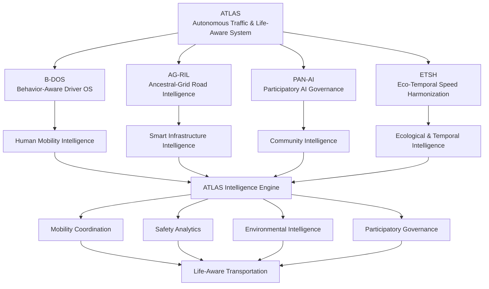
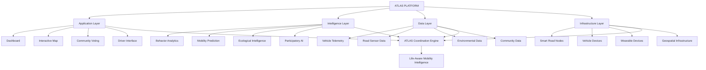

# 🌍 ATLAS
## Autonomous Traffic & Life-Aware System

### Cultivating Movement That Respects the Land, the People, and the Moment.

  <strong>A PLANETARY-INSPIRED AFRICAN MOBILITY INTELLIGENCE PLATFORM</strong>
   
  <em>Building a safe, just, intelligent, and nature-synchronized transportation future.</em>

  <a href="#-vision">Vision</a> •
  <a href="#-core-technology">Core Technology</a> •
  <a href="#-system-architecture">Architecture</a> •
  <a href="#-impact-engine">Impact</a> •
  <a href="#-roadmap">Roadmap</a> •
  <a href="#-contributing">Contributing</a>

---

> "He who walks with the ancestors knows how to travel without causing harm."

---

# 🌱 01. The Vision

Transportation is one of the most fundamental systems shaping human civilization.

It connects communities, enables economic activity, facilitates cultural exchange, and determines how people interact with their environments.

Yet conventional intelligent transportation systems primarily optimize traffic flow, vehicle throughput, and enforcement.

ATLAS proposes a different approach.

**What if transportation intelligence could understand not only vehicles and roads, but also human behavior, community needs, ecological systems, and the natural rhythms of the land?**

ATLAS is an African-inspired mobility intelligence platform designed to explore this possibility.

It brings together artificial intelligence, behavioral science, embedded sensing, participatory governance, and ecological intelligence to create transportation systems that prioritize life.

Our vision is to develop a mobility ecosystem where:

- Drivers become active participants in road safety.
- Roads respond intelligently to their surroundings.
- Communities participate in transportation governance.
- Wildlife movement is incorporated into infrastructure planning.
- Speed and mobility adapt to environmental conditions.
- Data is transparent, accountable, and responsibly governed.
- African cultural knowledge informs the future of mobility innovation.

**ATLAS does not simply seek to manage traffic. It seeks to cultivate movement that respects the land, the people, and the moment.**

---

# 🧭 02. Our Mission

Our mission is to build an intelligent, participatory, and ecologically aware transportation infrastructure that improves the safety and quality of movement across Africa and beyond.

We seek to connect four fundamental dimensions:

| Dimension | Purpose |
|---|---|
| Human Intelligence | Understand behavior, responsibility, and mobility needs |
| Infrastructure Intelligence | Make roads responsive to real-world conditions |
| Collective Intelligence | Incorporate community knowledge into governance |
| Ecological Intelligence | Harmonize transportation with natural systems |

ATLAS is designed around one foundational principle:

**Mobility should serve life, not force life to adapt to mobility.**

---

# 🧬 03. Core Technology

ATLAS is built around four interconnected technological pillars.

## I. B-DOS
### Behavior-Aware Driver Operating System

B-DOS introduces a driver-centered intelligence layer designed to promote safer driving behavior and greater road responsibility.

Rather than relying exclusively on punishment and enforcement, B-DOS explores ways to encourage voluntary behavioral improvement through feedback, education, and responsible gamification.

### Core Capabilities

- Driver safety monitoring.
- Vehicle telemetry integration.
- Driving behavior analysis.
- Gamified responsibility systems.
- Trip safety scoring.
- Fatigue-risk awareness.
- Driver feedback and coaching.
- Fleet safety analytics.

### Potential Sensing Technologies

- In-vehicle cameras, subject to consent and strict privacy controls.
- Optional biometric wearables.
- Vehicle telemetry.
- GPS and movement sensors.
- Driver interaction interfaces.

### Behavior-Aware Intelligence

B-DOS may evaluate driving patterns such as:

- Harsh acceleration.
- Sudden braking.
- Unsafe cornering.
- Speed consistency.
- Driving duration.
- Fatigue-risk indicators.

Facial microexpression analysis and biofeedback are exploratory research concepts, not established measures of driver fitness or emotional state. Any use must undergo scientific validation and explicit privacy assessment.

**Philosophy:**

A safer driver is not merely someone who avoids punishment. A safer driver understands their responsibility to everyone sharing the road.

---

## II. AG-RIL
### Ancestral-Grid Road Intelligence

AG-RIL explores the concept of roads that sense, communicate, and respond to their surrounding environment.

It combines intelligent infrastructure with ecological and community-aware transportation design.

The term *Ancestral-Grid* reflects the project's ambition to integrate traditional environmental knowledge, historical movement patterns, and contemporary infrastructure intelligence.

### Core Capabilities

- Distributed road sensing.
- Infrastructure condition monitoring.
- Environmental signal detection.
- Wildlife movement alerts.
- Smart road coordination.
- Solar-powered infrastructure nodes.
- Road hazard identification.
- Adaptive traffic signaling.

### Potential Infrastructure

- Embedded vibration sensors.
- Solar-powered roadside nodes.
- Environmental monitoring stations.
- Vehicle detection systems.
- Geospatial positioning.
- Wildlife movement sensors.
- Smart traffic signals.

### Ecological Awareness

Road systems can be designed to account for:

- Animal migration patterns.
- Wildlife crossing locations.
- Seasonal environmental changes.
- Flood-prone roads.
- Weather conditions.
- Pedestrian activity.
- Sensitive ecological corridors.

**Philosophy:**

A road should understand the environment it crosses.

---

## III. PAN-AI
### Participatory AI Governance

PAN-AI introduces community participation into the development and governance of transportation intelligence.

It explores decentralized AI governance mechanisms where communities, transport operators, researchers, and ecological stakeholders contribute relevant knowledge.

The objective is to ensure that mobility systems are not designed exclusively around centralized technical or institutional perspectives.

### Core Capabilities

- Community intelligence collection.
- Citizen reporting.
- Multi-dialect interfaces.
- Voice-to-data interaction.
- Participatory decision-making.
- Public transportation dashboards.
- Community data boards.
- Transparent AI governance.

### Participatory Intelligence

Potential stakeholders include:

- Public transport operators.
- Drivers and conductors.
- Pedestrians.
- Local communities.
- Urban planners.
- Wildlife conservation organizations.
- Transport authorities.
- Researchers and universities.

### Community Governance

PAN-AI explores processes through which community members can:

1. Report transportation problems.
2. Identify dangerous road conditions.
3. Contribute local environmental knowledge.
4. Review mobility proposals.
5. Participate in consultations.
6. Monitor public transportation outcomes.

**Philosophy:**

The people who live with transportation systems should have a meaningful voice in shaping them.

---

## IV. ETSH
### Eco-Temporal Speed Harmonization

ETSH explores adaptive transportation systems that respond to changing environmental and temporal conditions.

Traditional road speed limits are generally established through fixed regulatory frameworks.

ETSH investigates how transportation recommendations and infrastructure controls could become more responsive to changing conditions.

### Core Capabilities

- Context-aware speed recommendations.
- Wildlife migration awareness.
- Weather-sensitive mobility.
- School-zone and pedestrian safety.
- Ecological corridor protection.
- Seasonal mobility planning.
- Time-sensitive notifications.

### Natural and Cultural Intelligence

The system explores alignment with:

- Animal migration cycles.
- Seasonal environmental patterns.
- Agricultural calendars.
- Community activity rhythms.
- Local cultural calendars.
- Pedestrian movement patterns.

Drum-beat notifications represent a possible culturally inspired communication interface, not a universal substitute for conventional road safety signals.

Any adaptive speed enforcement must operate within applicable transportation laws, approved engineering standards, and human safety requirements.

**Philosophy:**

Time is not experienced uniformly across every landscape. Mobility systems should understand the conditions that shape movement.

---

# 🏗️ 04. System Architecture

ATLAS is conceptually organized into four primary intelligence pillars connected through a shared mobility infrastructure.

### Operational Layers

| Layer | Responsibilities |
|---|---|
| Driver Layer | Behavior monitoring and driver assistance |
| Road Layer | Smart infrastructure and environmental sensing |
| Community Layer | Citizen participation and governance |
| AI Layer | Data analysis and decision support |
| Ecological Layer | Wildlife and environmental intelligence |
| Analytics Layer | Safety, impact, and performance measurement |
| Governance Layer | Privacy, accountability, and public oversight |

---

# 📊 05. Impact Engine
### Real-Time Mobility Intelligence

The ATLAS Impact Engine is designed to provide transparent insights into transportation safety, community participation, and ecological outcomes.

Rather than evaluating transportation performance solely through traffic throughput, ATLAS explores a broader set of life-centered indicators.

### Core Impact Indicators

| Indicator | Purpose |
|---|---|
| Driver Safety Score | Monitor driving behavior and safety patterns |
| Crash Risk Index | Estimate contextual road safety risks |
| Wildlife Crossings Detected | Monitor detected wildlife movements |
| Community Votes Cast | Measure participation in governance |

### Demonstration Dashboard

The supplied interface displays these example figures:

| Metric | Displayed Value |
|---|---:|
| Driver Safety Score | 94.7% |
| Crash Risk Index | 0.12 |
| Wildlife Crossings Detected | 847 |
| Community Votes Cast | 12.4K |

Additional interface indicators include changes of +2.3%, -15%, and +127, respectively.

These values are illustrative dashboard data until connected to documented pilot datasets and validated measurement methodologies. The relationship between each trend indicator and its associated metric should be clearly defined.

### Transparent Impact Measurement

The Impact Engine aims to support:

- Real-time data collection.
- Data provenance.
- Safety performance analysis.
- Environmental monitoring.
- Community participation measurement.
- Geographic impact reporting.
- Historical comparisons.
- Independent data audits.

**Our principle: Mobility intelligence must be measurable, explainable, and accountable to the people it serves.**

---

# 🌍 06. Transformative Difference

ATLAS proposes a broader transportation philosophy than conventional Intelligent Transportation Systems.

| Dimension | Standard ITS | ATLAS Vision |
|---|---|---|
| Purpose | Reduce congestion | Improve social harmony and ecological safety |
| Data Sources | Vehicles and infrastructure sensors | People, nature, infrastructure, and AI |
| Safety Method | Enforcement and traffic control | Driver responsibility and contextual safety |
| Technology Ethos | Control system | Life-aware mobility system |
| Environmental Role | Often secondary | Integrated into mobility intelligence |
| Community Role | Primarily system users | Active participants in governance |
| Desired Outcome | Reduced traffic incidents | Safer movement for people and other living systems |

ATLAS is not intended to replace essential road regulations or proven traffic engineering practices.

It aims to complement them with a broader understanding of transportation as a human, ecological, and social system.

---

# 🗺️ 07. Three-Year Development Roadmap

ATLAS is envisioned as a phased African mobility innovation initiative.

## Year 1 — Urban Pilots
Interface status: Active

### Focus: Kampala, Nairobi, Accra

Develop urban pilot environments integrating:

- Smart road hubs.
- B-DOS-equipped public transport vehicles.
- Driver safety monitoring.
- Community reporting.
- Road condition sensing.
- Mobility intelligence dashboards.

**Initial geographic focus:**

- Kampala, Uganda.
- Nairobi, Kenya.
- Accra, Ghana.

The interface marks this phase as active; individual pilot deployments and operational milestones require project-level verification.

## Year 2 — Wildlife Corridors
Interface status: Planned

### Focus: SADC and Great Lakes regions

Expand ecological mobility intelligence through:

- Wildlife movement detection.
- Intelligent wildlife crossing alerts.
- Ecological corridor mapping.
- Environmental road monitoring.
- Conservation partnerships.
- Regional mobility datasets.

**Geographic focus:**

- Southern African Development Community (SADC).
- African Great Lakes region.

## Year 3 — Continental Dashboard
Interface status: Vision

### Focus: Pan-African Mobility Intelligence

Develop a continental mobility justice and safety intelligence framework.

Potential capabilities:

- Regional transportation safety indicators.
- Cross-border mobility data interoperability.
- Wildlife corridor intelligence.
- Community participation analytics.
- Public infrastructure performance monitoring.
- Pan-African mobility justice index.

**Institutional ambition:**

Explore engagement with the African Union and relevant regional institutions to establish interoperable continental reporting standards.

The African Union is a potential institutional stakeholder, not a confirmed platform partner.

---

# 🐘 08. African Context, Knowledge & Ecological Intelligence

ATLAS recognizes that Africa's transportation future should not simply replicate infrastructure models developed for different geographical, cultural, and ecological environments.

African mobility systems have unique characteristics:

- Diverse public transportation networks.
- Rapidly growing urban populations.
- Significant informal mobility economies.
- Extensive rural road networks.
- Wildlife migration corridors.
- Distinct cultural and linguistic environments.
- Diverse local ecological knowledge.

ATLAS seeks to incorporate these realities into mobility innovation.

### African Knowledge Integration

Potential research and collaboration domains include:

- Indigenous ecological knowledge.
- Community-based road safety practices.
- Traditional environmental observation.
- Local languages and dialects.
- African urban mobility research.
- Community-centered infrastructure planning.

This knowledge should be incorporated through respectful engagement, consent, appropriate attribution, and benefit-sharing with contributing communities.

**An African vision for global mobility.**

---

# 🧠 09. AI & Mobility Intelligence

Artificial intelligence provides the analytical capabilities connecting the four ATLAS technology pillars.

### Potential AI Applications

- Driver behavior classification.
- Road hazard detection.
- Vehicle movement prediction.
- Environmental anomaly detection.
- Wildlife movement analysis.
- Contextual speed recommendations.
- Transportation demand forecasting.
- Community feedback analysis.
- Road safety trend identification.

### Human-Centered AI

ATLAS is designed around a human-centered intelligence philosophy.

AI should:

- Assist rather than replace human judgment.
- Explain consequential recommendations.
- Respect privacy and consent.
- Allow human review of disputed decisions.
- Avoid unjustified discrimination.
- Operate within clearly defined permissions.
- Support transparent public accountability.

AI-generated predictions should not be presented as verified facts without appropriate validation.

---

# 🔐 10. Data Governance, Privacy & Ethics

Trust is fundamental to life-aware mobility.

Because ATLAS explores transportation telemetry, cameras, wearable biofeedback, and community-generated information, robust data governance must be built into its architecture from the beginning.

### Foundational Principles

**Privacy by Design**

Collect only data necessary for clearly specified mobility and safety purposes.

**Informed Consent**

Provide understandable explanations and meaningful choices, particularly for biometric and camera-based features.

**Data Minimization**

Prefer non-identifying vehicle and infrastructure signals where they can achieve the same safety objective.

**Community Data Ownership**

Establish transparent governance arrangements for citizen-generated and community-controlled information.

**Accountability**

Make consequential automated recommendations traceable and subject to human review.

**Fairness**

Evaluate systems for bias across demographics, languages, transportation modes, and geographic regions.

**Security**

Protect infrastructure and personal information against unauthorized access, misuse, and manipulation.

### Special Protection for Biometric Technologies

Facial microexpression cameras and biofeedback wristbands require heightened safeguards.

ATLAS should not treat facial expressions as definitive proof of fatigue, impairment, intent, or emotional state.

Biometric monitoring should be optional where possible, independently validated, appropriately secured, and governed under applicable data protection requirements.

No driver should face automatic penalties solely because of an unverified AI inference.

### Governance Framework

The platform should develop clear policies covering:

- Data access.
- Collection and retention.
- Consent withdrawal.
- Data sharing.
- Independent auditing.
- Security incident response.
- Community oversight.
- Appeal and correction mechanisms.

---

# 🚦 11. Platform Features

ATLAS provides a unified digital experience for exploring and interacting with the mobility intelligence ecosystem.

| Module | Function |
|---|---|
| Home | Discover the ATLAS vision and platform |
| Dashboard | Monitor mobility intelligence and impact |
| Map | Explore geographic mobility and ecological activity |
| Vote | Participate in community decisions |
| Leaderboard | Explore driver and community achievement indicators |
| Sign In | Access authorized platform functionality |
| Get Started | Begin platform onboarding |

### Dashboard

Centralized operational interface for:

- Driver safety indicators.
- Crash risk analytics.
- Wildlife detection.
- Community participation.
- Regional mobility activity.

### Interactive Map

Geospatial visualization for:

- Smart road hubs.
- Traffic patterns.
- Wildlife corridors.
- Environmental alerts.
- Community-reported hazards.
- Regional mobility indicators.

### Participatory Voting

A community decision-making environment supporting:

- Mobility proposals.
- Road safety initiatives.
- Infrastructure priorities.
- Community feedback.
- Participatory oversight.

### Leaderboard

A gamified engagement environment intended to recognize positive safety behavior and community participation.

Recognition systems should avoid public exposure of sensitive driver information and should reward responsible participation without encouraging risky competition.

---

# 🔧 12. Technical Architecture & Engineering Direction

ATLAS requires an extensible architecture capable of integrating vehicles, roadside infrastructure, community applications, and environmental intelligence.

### Conceptual Infrastructure

### Engineering Priorities

- Modular architecture.
- Edge computing for roadside and vehicle systems.
- Reliable sensor data ingestion.
- Real-time event processing.
- Geospatial data infrastructure.
- AI model monitoring and validation.
- Secure identity and access management.
- Resilient connectivity.
- Privacy-preserving analytics.
- Interoperable transport data standards.

The specific frameworks, programming languages, databases, communication protocols, and infrastructure providers should be documented as the implementation is established.

---

# 🌐 13. Potential Impact Areas

ATLAS seeks to create benefits across several interconnected dimensions.

### Human Safety
Improve road safety through contextual awareness, driver assistance, and preventive intelligence.

### Social Justice
Give communities greater influence in transportation planning and infrastructure priorities.

### Ecological Protection
Integrate wildlife movements and sensitive environmental areas into transportation decisions.

### Economic Development
Support efficient public transport, safer mobility, and technology-driven employment.

### Cultural Preservation
Incorporate locally relevant knowledge, languages, and community practices.

### Institutional Innovation
Create opportunities for collaboration between transport authorities, researchers, civil society, and technology developers.

---

# 🤝 14. Partnerships & Ecosystem

ATLAS is intended to develop through collaboration across Africa's mobility, technology, environmental, and research communities.

### Potential Partners

- Public transport operators.
- Municipal governments.
- Road authorities.
- Universities and research institutions.
- Wildlife conservation organizations.
- Technology startups.
- Civil society organizations.
- Regional transportation bodies.
- Community representatives.
- International development institutions.

### Collaboration Opportunities

- Urban mobility pilots.
- Smart road infrastructure.
- Public transport safety.
- Wildlife corridor protection.
- Community data governance.
- Mobility research.
- AI and sensor development.
- Regional mobility intelligence.

---

# 🔬 15. Research & Development

ATLAS intersects multiple research disciplines.

| Research Domain | Application |
|---|---|
| Artificial Intelligence | Mobility prediction and behavior analysis |
| Cyber-Physical Systems | Connected roads and vehicle infrastructure |
| Behavioral Science | Driver safety and responsible mobility |
| Edge Computing | Local real-time intelligence |
| Environmental Science | Ecological and wildlife monitoring |
| Geospatial Intelligence | Roads, movement, and spatial analytics |
| Human-Computer Interaction | Driver and community interfaces |
| Cybersecurity | Connected infrastructure protection |
| Public Policy | Mobility justice and institutional governance |
| Cultural Informatics | Local knowledge and language integration |

---

# 🗺️ 16. Development Roadmap Summary

| Phase | Initiative | Status in supplied concept |
|---|---|---|
| Year 1 | Kampala, Nairobi, Accra urban pilots | Active |
| Year 2 | SADC and Great Lakes wildlife corridors | Planned |
| Year 3 | Pan-African mobility intelligence dashboard | Vision |

Detailed implementation milestones, pilot results, and deployment evidence should be published as they become available.

---

# 🤝 17. Contributing

We welcome engineers, researchers, transportation professionals, environmental scientists, designers, and community innovators.

Potential contribution areas include:

- AI and machine learning.
- Embedded systems.
- IoT and sensor engineering.
- Geospatial intelligence.
- Transportation research.
- Road safety analytics.
- Wildlife conservation technology.
- Data governance.
- User experience design.
- Community participation systems.

### Contribution Process

1. Explore the repository.
2. Review the existing documentation.
3. Identify an issue or development opportunity.
4. Discuss significant architectural changes.
5. Submit a pull request with appropriate documentation and tests.

Contribution guidelines will be maintained in the repository as the development community grows.

---

# 📜 18. License

The project license has not yet been specified.

An appropriate license should be selected before public redistribution and contribution terms are established.

---

# 🌍 19. The ATLAS Philosophy

We believe a road is more than a strip of infrastructure.

It is a meeting point between people, nature, culture, technology, and time.

We believe a driver is more than a vehicle operator.

They are a participant in a shared responsibility for life.

We believe a city is more than a collection of streets.

It is a living system of communities, economies, and ecological relationships.

We believe artificial intelligence should do more than optimize movement.

It should help humanity make wiser decisions about how, when, and where we move.

And we believe Africa has the knowledge, creativity, and technological potential to help shape the future of global mobility.

---

# 🐘 ATLAS

## Cultivating Movement That Respects the Land, the People, and the Moment.

**An African vision for global mobility.**

The future of transportation is not simply about moving faster.

It is about moving more intelligently, more responsibly, and more harmoniously with all life.

  <strong>ATLAS</strong>
   
  <em>AUTONOMOUS TRAFFIC & LIFE-AWARE SYSTEM</em>
    
  AFRICA'S VISION. HUMANITY'S JOURNEY. LIFE'S FUTURE.

---

  <strong>Platform</strong> •
  <strong>Technology</strong> •
  <strong>Roadmap</strong> •
  <strong>Impact</strong> •
  <strong>Research</strong> •
  <strong>Community</strong>
    
  <em>Partner With Us · Explore Pilot Regions · Build With Us</em>
    
  © ATLAS. A vision for Africa, a gift to the world.

